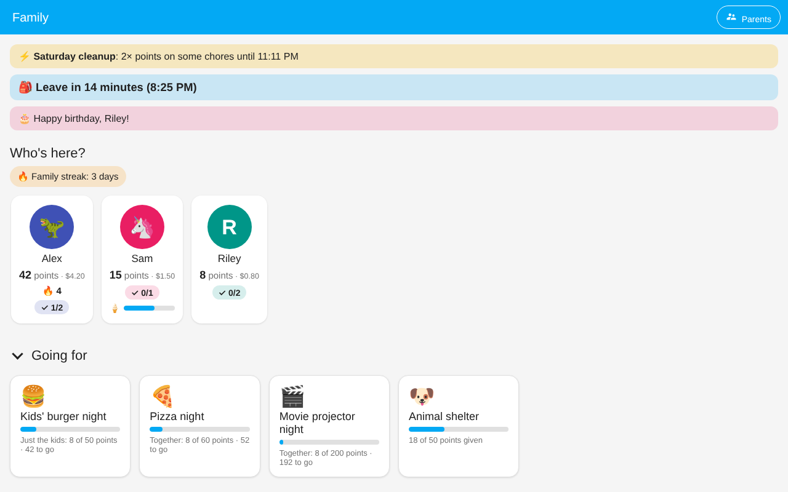
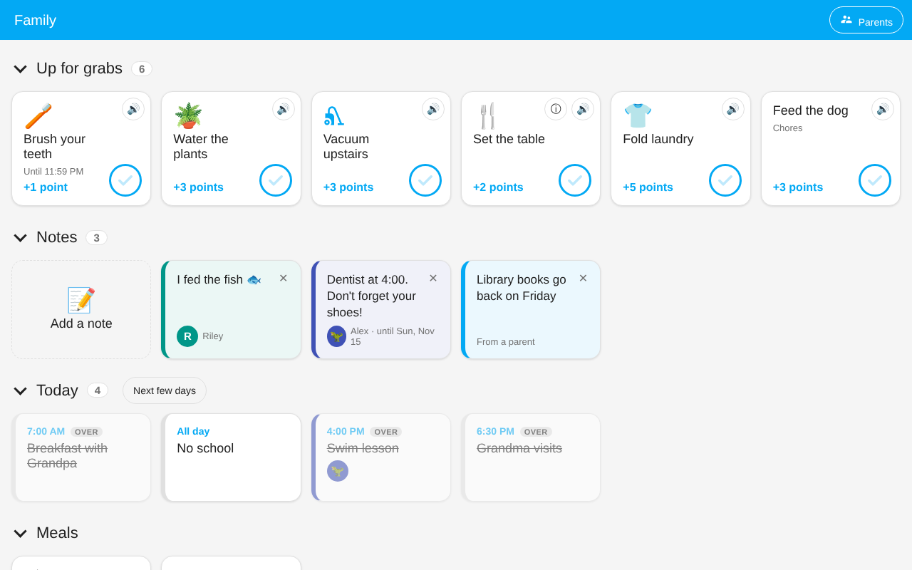
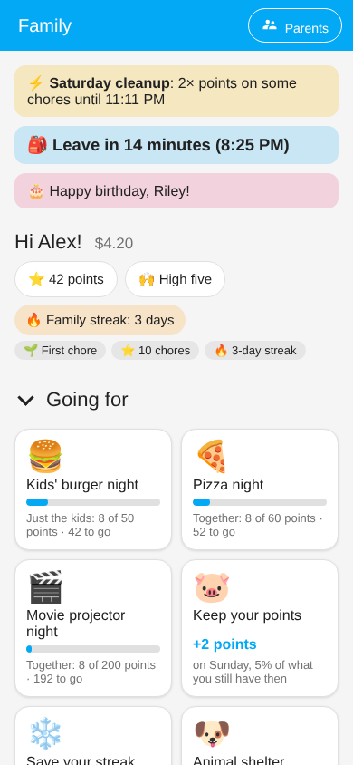
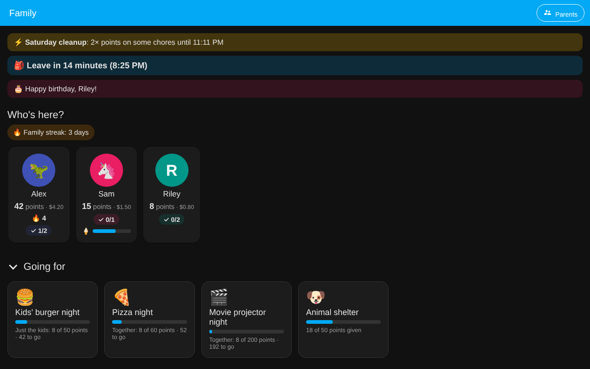
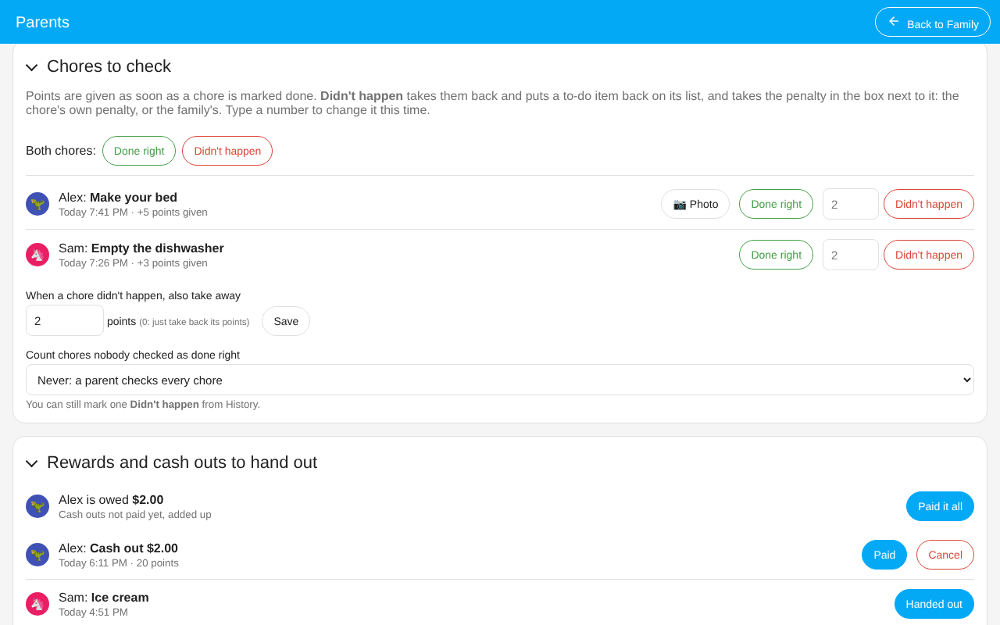
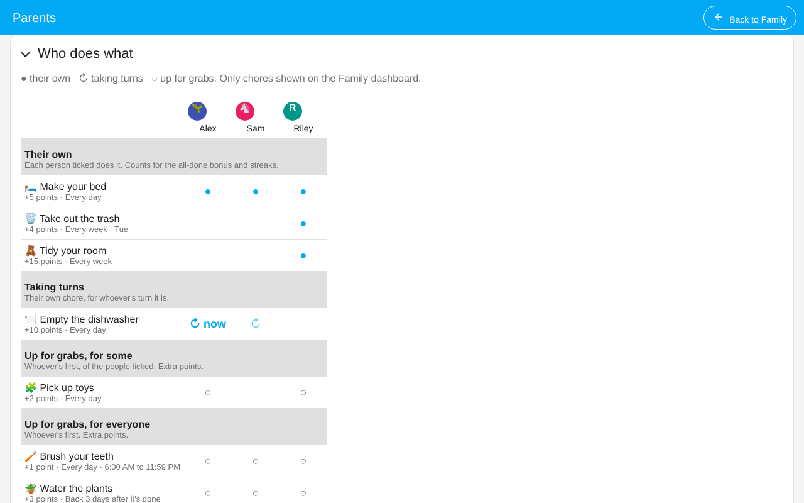
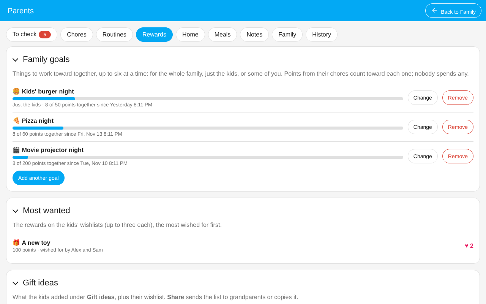
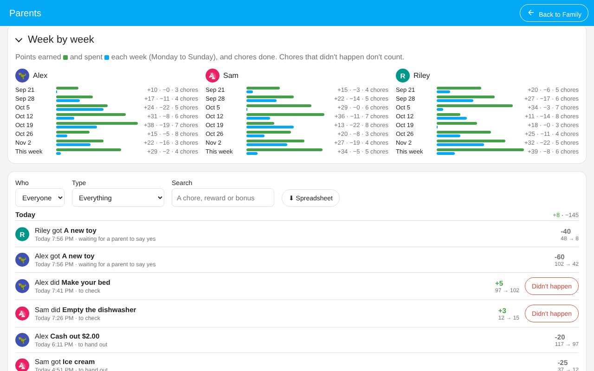

<p align="center">
  
</p>

# Family

[](https://hacs.xyz/)
[](https://www.home-assistant.io/)
[](https://github.com/bisman-automations/ha-family/releases)
[](https://github.com/bisman-automations/ha-family/actions/workflows/test.yml)
[](https://github.com/bisman-automations/ha-family/actions/workflows/validate.yml)
[](LICENSE)

**Chores and rewards for the whole family, in Home Assistant.** Kids mark chores done on a shared screen and earn points straight away. They spend the points on rewards, such as TV time with [TV Mgmt](https://github.com/bisman-automations/ha-tv-mgmt) or anything you add, and you choose who can get each reward. Parents check the chores later and take the points back if one didn't happen.

Chores and rewards are the first part of Family; more family tools will join them.

## Requirements

- Home Assistant 2026.8 or newer.
- For TV time rewards: [TV Mgmt](https://github.com/bisman-automations/ha-tv-mgmt) 1.20.0 or newer, with the TVs set up. With 1.21.0 or newer, TV Mgmt's Activity shows whose reward the time was, and its Live Activity on your phone counts down the time the kids earned.
- For music time rewards: [Media Mgmt](https://github.com/bisman-automations/ha-media-mgmt), with the speakers set up. With 1.5.0 or newer, its Activity shows whose reward the time was, and a reward can also give time to the whole home's limit.
- Optional: to-do lists (for example Local To-do, or Apple Reminders synced to Home Assistant) for chores.
- Optional: the Home Assistant app on the parents' phones, to check chores from a notification.

## Installation

### Marketplace (Home Assistant 2026.11 and newer, recommended)

[](https://my.home-assistant.io/redirect/marketplace_repository/?owner=bisman-automations&repository=ha-family&category=integration)

1. Open the Marketplace and search for **Family**, or select the button above to open this repository in the Marketplace.
2. Download **Family** and restart Home Assistant.

New versions show up under **Settings > Updates**. Already installed Family
with HACS? There's nothing to do: Home Assistant moves it into the Marketplace
the first time it starts on 2026.11.

If the search doesn't list it, choose **Add from link**, enter
`bisman-automations/ha-family` under **GitHub link**, and select **Add**.
Adding a repository from a link needs a GitHub connection; the Marketplace asks
you to connect one if you haven't.

### HACS (Home Assistant 2026.10 and older)

[](https://my.home-assistant.io/redirect/hacs_repository/?owner=bisman-automations&repository=ha-family&category=integration)

1. Open HACS and search for **Family**, or select the button above to open this repository in HACS.
2. Download **Family** and restart Home Assistant.

### Custom repository

If **Family** does not appear in search:

1. In HACS open the menu, choose **Custom repositories**, and add `https://github.com/bisman-automations/ha-family` as an **Integration**.
2. Download **Family** and restart Home Assistant.

### Manual

1. Download `family.zip` from the [latest release](https://github.com/bisman-automations/ha-family/releases/latest).
2. Unzip it into `config/custom_components/family/` and restart Home Assistant.

## Setup

[](https://my.home-assistant.io/redirect/config_flow_start/?domain=family)

Select the button above, or go to **Settings > Devices & services > Add
integration** and search for **Family**. Family is set up once; there's nothing
to fill in. **Family** appears in the sidebar, for everyone. It's made for a
shared touch screen such as a wall tablet or a kitchen display, and the
**Parents** button at the top switches it to the parent controls (see
[Parent controls and the parent PIN](#parent-controls-and-the-parent-pin)).

In the parent controls:

1. Under **Family**, add each family member. Pick an emoji and a color, and link them to their Home Assistant person if they have one: its picture is used, and if they log in to Home Assistant, the Family dashboard opens on their own page.
2. Under **Chores**, add chores, and add any to-do lists whose items are chores.
3. Under **Rewards**, add what points can buy, and who can get each one. Everyone is the default.
4. Under **Home**, add anything the family should be able to use or see from their dashboard, such as a movie-night scene, the playroom lights or the outside temperature.

## The Family dashboard





 

- **Who's here?** Everyone's picture and points, and how many of their own chores are left today (or **All done**). A chore whose hours are over for the day shows as **missed**. Tap yours to see your page.
- **Going for** (on your own page). How many of today's own chores are done and the bonus for finishing them, your streak (🔥 days in a row) and the next streak bonus, and the reward you're saving for.
- **Coming up.** Countdowns a parent added ("Beach trip · 12 days", then **Tomorrow** and **Today!**), and birthdays from a month before. On someone's page, theirs and everyone's.
- **What's for dinner?** While a parent has a dinner vote going, tap a choice to vote (on everyone's page, then pick who's voting). One vote each; tap another choice to change it. Each choice shows its votes and who voted. Once it closes, it shows the winner, which is also on the meal plan.
- **Notes.** Short notes and reminders for everyone, or for one person on their page. Tap **Add a note** to put one up from the screen, and ✕ to take it down. A note a parent put up can only be taken down by a parent. A note can show until a chosen day, then it goes by itself.
- **Today.** Today's events from the calendars a parent picked, all-day ones first. On someone's own page, their calendar and the family's. Events that are already over stay, faded and marked **Over**. Tap **Next few days** for today, tomorrow and the five days after, in a pop-up.
- **Meals.** Today's and tomorrow's breakfast, lunch and dinner, as planned in the parent controls.
- **My chores** and **Up for grabs.** On your own page, **My chores** are yours to do: finishing them all earns the all-done bonus and keeps your streak going. **Up for grabs** are extra: whoever does one first gets the points. Everyone's page shows only what's up for grabs for everyone; a chore up for grabs for some people shows on their own pages. Tap the round check box on a chore to tick it off; the points are added straight away. On your own page, or for a chore only one person can do, that's it; otherwise it asks who did it. Tapping the rest of the tile does nothing, so a stray tap doesn't tick anything off. When it asks who did it, **Did someone help?** lets you tick the brothers and sisters who helped: the points are split between you (as evenly as they go), and each helper's share shows in their History. A chore with an **ⓘ** has instructions or an example photo: tap it to see how it's done.
- **Routines.** Checklists such as Morning or Bedtime. Tap one to open its steps and tick them off one at a time (on everyone's page, pick who's doing it first). Ticking the last step finishes it: the points are given straight away and it waits for a parent, like a chore. Ticked steps start fresh each day.
- **Family goals** (under **Going for**). Up to six things to work toward together, such as Pizza night at 200 points, each with a bar showing how far you've got. A goal for just the kids, or for some of you, shows only on their pages (and on everyone's).
- **Rewards.** Only rewards for you, or for everyone. On everyone's page, only rewards for everyone; a reward for certain people shows on their pages. Tap one and confirm. TV time is given on that TV in TV Mgmt at once, and music time on that speaker in Media Mgmt; anything else waits for a parent to hand it out. Rewards you can't afford yet say how many more points you need, and one that can only be had once a day or once a week says when it's back. A reward for nobody doesn't show, and it can't be got until a parent chooses who it's for.
- **Undo.** Tapped the wrong name or chore? Tap **Undo** on the message that pops up. It works for a minute, for a chore not checked yet and a reward not handed out yet; TV time is taken back off the TV.
- **Home.** The scenes, lights and other things a parent added. Tap one to use it: a scene or script starts, a light or switch turns on or off, blinds open or close, a lock locks or unlocks, and a speaker plays or pauses. Anything that asks first shows "Are you sure?". Sensors, thermostats and the weather are only shown. Each tile shows what it's doing now.
- **Getting a reward together.** Tap a reward, then **Get it together**, and pick who's putting in points. Only people the reward is for can join. The points are shared as evenly as everyone's points allow: someone with fewer puts in what they have and the others cover the rest. Tap **Ask a parent**: the points are held (taken off everyone's points) until a parent says yes. If a parent says no, everyone gets their points back.
- **Saving up.** On your own page, tap a reward you can't afford yet and pick **Save for this**. Your page shows how far you are, and your picture on **Who's here?** has a little bar. Once you get it, you're done saving; tap it again and pick **Stop saving for it** to change your mind.
- **Turns.** A chore the kids take in turns says whose turn it is, and only they can do it.
- **Lately.** What was done and spent recently.
- **Done today.** What's finished today, ticked off, under its own section.
- **Ask for something** (under **Rewards**, on your own page). Ask for a reward that isn't on the list, such as a sleepover, and optionally say how many points you think it's worth. It shows as **Waiting for a parent** (✕ takes it back), then **Yes!** (it's now one of your rewards) or **Not this time**. Answered asks go away after three days.
- **Your points story and high fives** (top of your own page). Tap **⭐ points** to see what earned and spent your points lately, with your points before → after each. Tap **🙌 High five** to send someone a high five or a thank-you (🙌 ⭐ ❤️ 👏 🎉 🤝). It has no points; it shows in their Lately. Up to 10 a day each.
- **Family streak** (top of every page). 🔥 Days in a row everyone finished their own chores, with a 🏅 from a week. A day nobody had their own chores doesn't break it.
- **Read it to me.** 🔊 on a chore or a routine step reads it out loud on the screen, for kids who can't read yet. A person set to **Picture mode** sees big pictures on their chores instead of words; tapping the picture reads it.
- **Chore timer.** A chore with a timer shows **⏱ 10 min**: tap it to start the countdown on the tile. A beep and a message say when time's up. Tick the chore off before then to earn its timer bonus.
- **Tomorrow.** On your own page, your chores for tomorrow and tomorrow's events; on everyone's, tomorrow's events and how many chores each person has.
- **What to wear.** Today's weather in kid terms, such as "Cold. Wear a coat and a hat. Bring an umbrella or a rain jacket."
- **Links.** Web pages a parent added, such as the school lunch menu. Each opens over the dashboard on its own, with no address bar and a **Close** button. Some sites don't allow being shown inside another page; then use **open it in a new tab**.
- **Screen time left.** Each TV in TV Mgmt and speaker in Media Mgmt, with the minutes left today, kept up to date.
- **Across the top:** 🏖️ when the family is away (chores are off), ⚡ while double points are on (chores worth more also say **2× points** on their tile, with what they're worth now), and 🎂 on someone's birthday. On a birthday, their own page says **Happy birthday!** instead of Hi.

### Badges

Badges are earned along the way and show under someone's name on their page: 🌱 **First chore**, ⭐ **10 chores**, 🌟 **50 chores**, 🏆 **100 chores**, 🎉 **All done** (all their own chores in a day), 🔥 **3-day streak** and **Week streak**, 💎 **30-day streak**, 🎁 **First reward** and 💰 **Cashed out**. A new one pops up after the chore or reward that earned it. Once earned, a badge stays, even when the history that earned it is long gone.

### Trading chores

On someone's page, the ⇄ on one of their own chores offers it for today, to one person or to anyone. Whoever wants it taps **Take it** on their page, and a parent says yes or no in the parent controls under **To check** (the parents' phones get a notification when **Parents' phones** gets chores done). Until a parent says yes it stays with whoever had it, and **Take back** withdraws the offer. A yes lasts for today only; tomorrow the chore is back with its usual people. Chores up for grabs and to-do items can't be traded, and nobody can take a chore they already have.

### Cashing out

When a parent has set what a point is worth (**Family** → allowance and money), someone's **Rewards** start with **💰 Cash out**: pick how many points to turn into money. The points are taken straight away, and the cash out waits under **To check** → **Rewards and cash outs to hand out** until a parent marks it **Paid**, or **Cancel**s it, which gives the points back. Above them, each person's unpaid cash outs are added up ("Alex is owed $3.50"), with **Paid it all** to mark them all paid at once, for example after a bank transfer.

### Photos of chores done

A chore can ask for a photo (**Photo when it's done**: ask for one, or needs one). Marking it done then opens the camera: take the picture, then **Yes, it's done!**. With **Needs one**, it can't be marked done without a photo. Under **To check**, **📷 Photo** shows it. Photos are kept for two weeks, and go straight away when a chore is undone.

### Pick your chores

Tick **In the pick-your-chores pool** on a chore, and it belongs to nobody until someone picks it for the week. **Pick your chores** on the Family dashboard shows whose turn it is: whoever has picked the fewest points this week goes next, so the big chores get shared out. Tap a chore to pick it; it's then that person's own chore for the week. Tick who can pick each one under **Who can do it** (nobody ticked: everyone). Under **Chores** → **Pick your chores**, **Points each picks a week** stops someone picking once they have that much (0: no limit). A parent can put a pick back with **Put back** in the chores list. The picks start again every Monday.

### Chores that wait for something, or start something

**Only when this… shows** keeps a chore off the Family dashboard until something shows one of the states you type, such as Daily Routine's **Kind of day** being *School day*, or the house mode. **When it's done, also start** runs a script, scene or button as soon as the chore is marked done, such as one that gives TV time or turns the desk lamp off once homework is done.

### Chores a device finishes

**Done when this device… changes to** marks a chore done when a device does it: a robot vacuum back on its dock (`docked`), the dishwasher door opened (`on`), the washing machine finished. Whoever started the device from Home Assistant (their login, linked through their person) gets the points. If that isn't known, and the chore isn't just one person's, the Family dashboard shows it under **Who did this?** until someone taps it and says it was them.

### Wall view

For a TV or a tablet on the wall: everyone's points, today's progress and their chores, big enough to read across the room, with what's up for grabs and today's calendar underneath. Open the Family page with `#wall` at the end of its address (`/family#wall`), or add the Family card with `wall: true`:

```yaml
type: custom:family-card
wall: true
```

### Chore bingo, races and the give jar

- **Chore bingo.** With points set for it (under **Family** → **Bingo, races and the evening check-in**), each person's page has a 3×3 card of nine of their chores, new every Monday. Doing a chore marks its square; every row, column or diagonal earns points, and the whole card more. It needs nine chores they can do.
- **Races.** **Race someone** (under **Going for**) challenges a brother or sister: whoever finishes all of today's own chores first wins the race's points. Undoing or rejecting the winning chore opens the race again.
- **The give jar.** When a parent sets what the family gives for (such as an animal shelter), its tile shows how far everyone has got. On their own page, a child taps it to give some of their points; a share of each allowance can go in by itself.
- **Offer to do a chore.** Next to **Ask for something** under **Rewards**, a child offers a chore that isn't on the list ("Wash the car") and how many points they think it's worth. A parent's yes adds it as a one-off chore of theirs.
- **How was today?** With the evening check-in on, each person taps how their day was. Only parents see it, under **History**.
- **Time to leave.** On days a parent set a leave time, a countdown shows across the top (and on the wall view) from shortly before: "Leave in 14 minutes".

### Quests, pets, wishlists and more

- **Quests.** A bigger job in steps, such as clearing out the garage. The steps open one at a time under **Quests**; whoever does one taps it (on everyone's page, then says who) and gets its points.
- **Pets.** Each pet's meals (or walks) at set times. A time can be ticked off from an hour before it, once, so nobody feeds the dog two breakfasts; it's late an hour after. Each one is checked under **To check** like a chore, and can be undone like one.
- **Save your streak.** With streak freezes on, someone who missed yesterday (or can't finish today) can spend points to make it a day off, once a week.
- **Paying for a trade.** When offering a chore to trade, a child can add some of their own points for whoever takes it; they move when a parent says yes.
- **Wishlist.** On a reward's sheet, **♡ On my wishlist** marks up to three rewards someone wants most. Parents see **Most wanted** on the **Rewards** tab.
- **Chore auctions.** Bid how few points you'd do a job for; the lowest bid when time's up gets it.
- **Reading.** **Log reading** with the minutes (and the book) for points, checked like a chore.
- **Swap market.** Chores offered to anyone, in one place: tap one to take it (a parent still says yes).
- **Theme week.** While a theme week is on, tap each day you kept it.
- **Homework timer.** Start it when sitting down to homework and tap it when done; points for every so many minutes, checked like a chore.
- **Keep your points.** With the saving bonus on, a kid's page shows what they'll get on allowance day if they keep their points.
- **Trade for the week.** When offering a chore to trade, **For the rest of the week** makes it theirs through Sunday.
- **Gift ideas and saved TV time.** On their own page, kids add gift ideas, and use TV minutes they saved on other days.
- **Quiet hours.** Between the times a parent sets, the shared screen rests after a while with no taps: a big clock, time to leave and notes for everyone. A tap wakes it.

### On a kid's own phone

Add `#me` to the end of the Family page's address on a child's phone (`/family#me`), or add the Family card with `phone: true`. If their Home Assistant login is linked to their family member (through their person), it opens straight on their page with only what's theirs: what they're going for, their chores, picks, routines, up for grabs, rewards and tomorrow. There's no people strip to switch to someone else.

```yaml
type: custom:family-card
phone: true
```

### Asking Assist

With Home Assistant's Assist (a voice speaker, or typing to Assist in the app), anyone can say:

- "**I finished** feed the dog", or "**Alex did** make your bed": marks the chore done, the same as tapping it, so it still waits for a parent's check.
- "**How many points do I have?**", or "How many points does Sam have?"
- "**What chores do I have left?**", or "What does Riley have left?"

"I" works when the Assist device or app is logged in as someone linked to their Home Assistant person in the family; otherwise say the name. The sentences are in English, and Assist's other sentences keep working.

### Going back to everyone

After 5 minutes with nobody using the screen (no tap, scroll or key), the dashboard goes back to **Who's here?**, so the next person doesn't land on someone else's page. Scrolling or reading someone's page doesn't send it back, and neither does a change made somewhere else (a chore done on another screen, a light turned on). The person picked stays picked if Home Assistant reloads the dashboard (after a reconnect, for example) in the same browser tab. A screen that shows one person's page (their tab, or a card with their member id) stays on that page.

Each section shows its first row: as many tiles as fit across the screen. Tap **Show all** for the rest, or tap a section's name to fold it away. Each screen remembers which sections are open. A parent can change the order of the sections for every screen in the parent controls, under **Family** → **Family dashboard sections**. Tick **Hide sections with nothing in them** there to leave out a section that's empty, such as **Up for grabs** when nothing is up for grabs (**Notes** always shows, so a note can be added).

To show it on a shared display, point the display's browser or kiosk app at `/family` on your Home Assistant. The display can be logged in as a user who isn't an admin: everyone can mark chores done and pick rewards, but only admins can check chores or change anything. The display can only use the home controls a parent put on the dashboard, nothing else.

### As a shared screen's default dashboard

Home Assistant only lets a login pick a dashboard as its default, and the Family page in the sidebar isn't one. So in the parent controls, under **Family**, tap **Make a Family dashboard**. It makes a dashboard called **Family dashboard** that shows the Family page full screen, with a **Home** tab for everyone and a tab for each family member that always shows their page. It's left out of the sidebar, since **Family** is already there.

The tabs follow your family: adding, renaming or removing someone in the parent controls adds, renames or removes their tab. Anything you add to the dashboard yourself in Home Assistant, such as another card on a tab or a tab of your own, is kept. The button becomes **Update the Family dashboard** once the dashboard is there, for bringing the tabs back in line, for example after removing one by hand.

Then log in on the shared screen as its user, open your profile, and pick **Family dashboard** under **Dashboard**.

You can also put the **Family** card (`custom:family-card`) on any dashboard yourself, for example in a panel view. To show one person's page only, give it their member id (it's in the tab's card on the Family dashboard):

```yaml
type: custom:family-card
member: <member id>
```

## Parent controls and the parent PIN

**Parents** at the top of the Family page switches it to the parent controls; **Back to Family** switches back. The **Family** card on a dashboard has the same button.

- **Logged in as a Home Assistant administrator** (a parent's own phone or computer), **Parents** opens straight away.
- **Any other login** (the shared screen, a kid's tablet) asks for a **parent PIN**. Set them in the parent controls under **Family** → **Parent PIN**, from an administrator's login:
  - **Family PIN**: one PIN any parent can use. Any administrator can set, change or remove it.
  - **Your own PIN**: each administrator can set their own. **Back to Family** then shows who opened the parent controls. Only you can change yours, from your own login, and it stops working if your login stops being an administrator.

  Use either or both. PINs are 4 to 8 digits, no two can be the same, and Home Assistant only keeps a scrambled copy of each, never the PIN itself.
- The PIN opens the parent controls on that screen until **Back to Family**, or until nobody has used it (a tap, a scroll or a key) for two minutes. Restarting Home Assistant closes them too.
- After five wrong PINs in a row, the pad locks for five minutes and the phones picked under **Parents' phones** get a notification.
- With no PIN set, only an administrator's login can open the parent controls.
- Making or updating the **Family dashboard** (under **Family**) needs an administrator's login, since it changes Home Assistant's dashboards. Everything else works with the PIN.

Links to the old **Parents** page (`/family-parents`), including the ones in the parents' notifications, still open the parent controls.

## The parent controls









Every card in the parent controls folds away: tap its title. A folded card stays folded until you tap it again, and each device remembers which cards are folded.

- **Hold rewards** (on **Family**, next to each person). Puts their rewards on hold for the rest of today, 1, 2 or 3 days, a week, or through a day you pick, with an optional reason they'll see. While it lasts they can't get a reward (alone or together) or cash out; chores still earn points, and rewards they can't afford yet can still be saved for. Their Rewards section says until when. **Lift the hold** ends it early.
- **Quick points** (top of **To check**). Buttons for the things you want to notice, good and not so good, such as "💛 Kind to a sibling +2" or "🙉 Not listening −1". One tap next to someone gives or takes the points straight away, and it shows in History. Tap **Change the buttons** to set your own (up to 12; use a minus for points taken away). Each button is for everyone unless you untick people in its list; it then shows only next to whoever is still ticked.
- **To check.** Chores the kids marked done. **Done right** keeps the points; **Didn't happen** takes them back (and puts a to-do item back on its list). With more than one to check, **Done right** and **Didn't happen** above the list check them all at once; **Didn't happen** asks first, and each chore still takes its own penalty. Above them are rewards the kids want to get together: **Yes** gives the reward (TV and music time straight away), **No** gives everyone their points back. Below are rewards still to hand out; mark them **Handed out**. To keep the list short, pick **Count chores nobody checked as done right** after a day or a week; those show as "checked automatically" in History.
- **Who does what** (top of **Chores**). Every chore shown on the Family dashboard lined up against each person: ● their own, ↻ taking turns (with whose turn it is now), ○ up for grabs, grouped by kind, with how many of their own chores each person has done today.
- **Chores.** Add, edit or turn off chores. A chore can have a **timer** (minutes) and a **bonus for beating it**. Once someone has a birthday and year born, a chore can also have a **youngest** and **oldest age**: only people that age see and do it (someone whose age isn't known still does). With nobody ticked, it's up for grabs for everyone that age. For each: its points, when it **comes back**, who can do it (nobody ticked means anyone), and **How it's done**: **Their own chore** (each person ticked does it, and it counts for the all-done bonus and streaks) or **Up for grabs** (whoever's first, for extra points; with people ticked, only they see it). A chore with nobody ticked is always up for grabs. To-do lists have the same choice for their items. A chore comes back:
  - **every day** or **every week** (from Monday), or it's done **just once**;
  - **some days after it's done**, for example 3 days after the plants were last watered;
  - **right away**, every time it's done, for something that can be done again and again;
  - **once a parent checks it**: it stays done while it's on **To check**.

  **Picture** is an emoji or an icon. Tap it to pick one: search the icons (vacuum, dishes, laundry, dog, lawn…), tap an emoji, or type any emoji. Any of Home Assistant's icons works too: type its full name, such as `mdi:washing-machine`. Rewards, routines, family members, quick points, the family goal, countdowns, links and to-do items pick their picture the same way.

  **Which days** shows a chore only on those days, such as Tuesday for the trash, and **Shown from** / **Until** only between those times, such as 6:00 AM to 9:00 AM for a morning chore (times can cross midnight). The Family dashboard changes on its own when a chore's time starts or ends.

  **They take turns** makes the people ticked under **Who can do it** take turns: it's only for whoever's turn it is, and the turn moves on each time it's done, each day or each week. **Fairly** gives it to whoever has done it least in the last 30 days instead (a tie goes to whoever did it longest ago), so missed turns even out. Pick **Whose turn is it now?** to start or change it. If it didn't happen, it stays their turn.

  **How to do it** is a few lines on what done looks like, and **Example photo** a picture of it done right. Either puts an **ⓘ** on the chore's tile; tapping it shows them, and **Read it to me** reads the words aloud. The example photo is kept until you remove it.

  **Also keep it on a to-do list** puts the chore on a Home Assistant to-do list too. Family adds it while it can be done, ticks it off when it's done, and opens it again when it comes back. Renaming the chore renames the item, and removing the chore (or picking no list) removes it. If the list already has an item with the chore's name, Family uses that item instead of adding another, and leaves it on the list if the chore is removed. Set **When it shows** to **Only when due today or overdue** to keep the chore off the Family dashboard until its item's due date. The chore's tile shows the list's name. Ticking or editing the item on the list yourself doesn't change the chore. If that list is also a chore list, the item isn't counted as a second chore.
- **Chores from to-do lists.** Every open item on these lists is a chore, worth the list's points. Put the points at the end of an item to change them: `Feed the dog [5]`, `Feed the dog (5 points)` or `Feed the dog - 5 pts`. When it's marked done, the item is ticked off its list, so a repeating reminder comes back when its list brings it back. To give single items their own points without changing their text, tap **Points for items** next to the list: each open item has its own box, and an empty box uses the list's points (or the points written in the item). Set **When items show** to **Only when due today or overdue** to keep items with a later due date off the Family dashboard until their day; an item with a due time shows once that time comes, and items with no due date always show. Next to each item you can also tick who it's for; with nobody ticked, it's for the people ticked for the whole list. You can give an item its own emoji there too; it shows on the item's tile. Tick **Leave out** for an item that isn't a chore (a bill to pay, say): it stays on the list but never shows on the Family dashboard. Left-out items move into a folded **Left out** group at the end, so the list stays short. An item with the same name as a chore, or as another item already shown, isn't shown twice: the Family dashboard shows chores first, then each to-do item once. Points, people and emojis are kept by the item's name, so a repeating item keeps them when it comes back.
- **Routines** (its own tab). Add a routine with its steps (one on each line, up to 20; start a line with an emoji if you like), the points for finishing it, who does it (nobody ticked: everyone), and which days and hours it shows. Each person's finished routine shows under **To check** like a chore.
- **Family goals** (top of **Rewards**). Up to six things to work toward, and how many points each takes. **Who it's for**: the whole family, **Just the kids** (everyone who isn't a parent; only their points count, and it doesn't show on the parents' own pages), or **Some of us** (two or more people). Points from everyone's chores and bonuses count toward each one from the day it's set; nobody spends any, so everyone keeps their own points and the same points count toward every goal. When one is reached its bar says so; hand it out, then **Start again** or **Remove** it. Changing the name or target keeps counting; tick **Start counting again from now** to start over.
- **Gift ideas** (under **Rewards**). What each child added under **Gift ideas** on their page, plus their wishlist. **Share** sends it as a message (or copies it) for grandparents and friends.
- **Chore auctions** (under **Chores**). Put a bigger job up for auction, with the most points it's worth and how long bidding lasts. The kids bid how few points they'd do it for; when time's up, or you press **Close now**, the lowest bid (the first, on a tie) gets it as a one-off chore worth their bid. Nobody bid: nothing happens.
- **Team chores.** Under a chore's **How it's done**, **Team chore**: each person ticked ticks it, and their points count only once they all have (until then it says who's still to do it).
- **Grades** (under **To check**). Pick who, the subject and the grade; its points are given straight away. The grades and their points are set under **Family**.
- **Money paid out** (under **History**). Each month's cash outs and how much was paid, per child, with **⬇︎ Spreadsheet**.
- **Theme week** (under **Family**). A theme, points a day and its first and last day; each child taps once a day that they kept it, checked like a chore.
- **Shop days** (when editing a reward). Tick the days it can be bought; none ticked is any day.
- **Helping out** (under **Family**, with reading). Extra points for each helper when a chore is marked done with helpers.
- **Photos of the month** (under **History**). Every chore photo from this month or last on one page, with **Print**.
- **How hard** (when editing a chore). Easy, medium or hard, shown as stars on the tile.
- **Homework, points by age and rewards to buy** (under **Family**, with reading). Homework timer: points for every so many minutes, up to a limit a day. Points by age: older kids get a percentage more for each year over an age you pick (needs their birthday and year born). Rewards to buy: when someone gets a reward a parent hands out, it's added to the to-do list you pick ("A new toy for Alex").
- **Reading, allowance rules and beat the clock** (under **Family**). Reading log: points for every so many minutes read, up to a limit a day; the kids log it on the Family dashboard and it's checked like a chore. Allowance rule: when the weekly allowance is given, last week's days with their own chores (days with none don't count) decide it: all done on enough of them, it goes up by a percentage; on too few, down; the history says why. Beat the clock: points for finishing a routine ticked **Beat the clock** before today's time to leave.
- **Screen-time bank** (when editing someone, with TV Mgmt). For a TV they use on their own: just before midnight, the minutes TV Mgmt says it has left are saved, up to the most you set. They use saved minutes from the **Saved TV time** tile, and TV Mgmt gives that TV the extra time today.
- **Rewards.** Add what points can buy: **TV time** (pick the TV and the minutes, and optionally give the whole home the same time), **Music time** (pick the speaker and the minutes, given in Media Mgmt, and optionally give the whole home the same time) or **Something else** for a parent to hand out. **How often** limits each person to once a day or once a week, so all the points don't go on TV in one afternoon. **Who can get it** is a list of the family, with everyone selected to start. There is no Everyone checkbox and no Everyone row: the list is only people. Leave them all selected and anyone can get it, including people you add later (the row says "For: Everyone"). Untick people to limit it to whoever is still selected, for example "5 points · 15 min on Family Room TV · For: Alex, Sam". Untick all of them and the row says "For: nobody": the reward stays, but nobody can get it until you select someone. It does not go back to everyone. Removing a family member drops them from a reward that names them; if they were the last person, that reward becomes nobody's. A reward already saved for everyone stays that way, including people you add later. One that names particular people stays limited to them until you save it again.
- **Speaker reminders.** Pick a voice under **Family** → **Speaker reminders** (any text-to-speech in Home Assistant, such as Piper or Google Translate). Then, on a chore, set **Say it on a speaker**: a time and one or more speakers. At that time, on the chore's days, the speakers say who still has it to do ("Reminder for Alex and Sam: Set the table."). Nothing is said once it's done.
- **Home.** Pick what shows under **Home** on the Family dashboard, and in what order. Search for a scene, script, button, light, switch, fan, blind, valve, lock, speaker or TV, or for a sensor, thermostat or weather to show. Give it a different name or an emoji if you like, choose who sees it (nobody ticked means everyone), and tick **Ask "Are you sure?" first** for locks and doors. Anyone at the Family dashboard can use what's here, so only add what the kids may use.
- **Bonus points** (under **Rewards**). Extra points when someone finishes all of their own chores for the day (chores up for grabs don't count), and every so many days in a row, for example 10 points every 7 days. A streak is days in a row with all of their own chores done; up for grabs doesn't keep it going, and a day with none of their own chores is a day off that doesn't break it. With 0 all-done points, finishing still counts for the streak. A bonus goes away if its chore is undone or marked **Didn't happen**. A chore can have its own streak too: **Bonus every … days in a row** on the chore gives its **Streak bonus points** each time the same person has done it that many days (weeks, for a weekly chore) running.
- **Penalties.** **Didn't happen** always takes a chore's points back. To take more, set **When a chore didn't happen, also take away** under **To check** for the whole family, or a **Penalty if it didn't happen** on a chore or to-do list. The box next to **Didn't happen** shows the penalty that will be taken; type a number to change it just this time. Marking it **Done right** later gives everything back.
- **Phones** (under **To check**). Pick the parents' phones (any phone with the Home Assistant app), and what to send: a notification **when a chore is marked done**, with **Done right** and **Didn't happen** buttons; one **when a reward needs handing out**, with a **Handed out** button, and when the kids want a reward together, with **Yes** and **No** buttons; and **a summary of the week** every Sunday at 6:00 PM: each person's chores, points earned and spent, and how many chores are still to check. Only a parent's (admin's) phone can check a chore. Once a chore is checked anywhere, its notification goes away. Under **Live Activities of today's chores**, pick **One for the family** (each child's progress on one line, such as "Alex 3/5 · Sam ✓", then **All done today!**), **One for each child** (their own progress; **All done!** for a couple of minutes once they finish, then it goes), or both. Set **Show from** to when the kids get up, such as 6:30 AM: on iPhone a Live Activity ends after 8 hours. They count only children's own chores (not parents', not chores up for grabs) and start fresh each day.
- **Meals.** Plan breakfast, lunch and dinner for the week ahead. Leave a meal empty to leave it out. Fill in **To buy** on a day (one per line, or separated by commas), then under **Shopping list** pick a to-do list (such as the Shopping List integration's) and tap **Add to the shopping list**: everything today and the next six days need goes on it, except what's already on it and not ticked off.
- **Dinner vote** (under **Meals**). Give two to six choices, the day, and when voting closes (optional). Everyone votes on the Family dashboard. When it closes (by its time, or **Close the vote now**), the choice with the most votes wins (a tie goes to the one listed first) and becomes that day's dinner on the meal plan. **Take it down** ends it without a winner. One vote runs at a time.
- **Countdowns** (under **Notes**). Add a name, an emoji, the day, and who it's for (or everyone). It shows on the Family dashboard until the end of its day. Birthdays count down by themselves.
- **Add to the calendar** (under **Notes**, once calendars are picked under **Family**). Put an event on one of the family's calendars: a day with a start and end time, or an all-day event (optionally over several days).
- **Chores they offered to do** (under **To check**). Set the points and tap **Yes**: it becomes a one-off chore of that child's. **No** tells them not this time. Phones are told like for rewards asked for.
- **Rewards they asked for** (top of **To check**). What the kids asked for. Set what it costs and tap **Yes**: it becomes a reward for that child only. **No** tells them not this time. With **when a reward needs handing out** on under **Phones**, your phones are told when a child asks.
- **Double points** (top of **Chores**). Start double or triple points until a time you pick (at most two weeks), for every chore (to-do items too) or only the chores you tick, with an optional name such as "Saturday cleanup". **Stop** ends it early. A chore done while it's on is worth that many times its points; bonuses stay as they are.
- **Seasons** (on a chore). **Season** shows a chore only between two days of the year, every year, such as October 1 to November 30 for raking leaves, or December 1 to March 31 (it can wrap past New Year) for shoveling.
- **Notes.** Every note on the board, who put it up and until when. Put one up for everyone or for one person, or take any note down.
- **Family.** Add, edit or remove family members, and add or take away points by hand, with a reason. Each member can have an **allowance**: points added every week, and a **birthday** (month and day). Add the **year born** too, and chores can be set for some ages. **Picture mode** shows that person big pictures on their chores and reads them aloud. With TV Mgmt, **Their chores done unlock** gives minutes of TV (on one TV, or the whole home too) the moment they finish all of their own chores for the day; undoing a chore takes the time back.
- **Away** (under **Family**). For a trip: set the first day away and, optionally, the day you're back (the last day away). While away, chores and routines are off, nothing counts as missed, streaks skip those days (a day away is a day off), and the weekly allowance isn't given (it isn't made up later). Points, rewards and everything else keep working. **We're back home** ends it, and today counts as usual again. Trips that haven't started can be removed.
- **Quests** and **Pets** (under **Chores**). Add a quest with its steps, one on each line with the points at the end (`Sweep the floor [3]`), and who can do it; **Put back the last step** undoes one done by mistake (its points too). Add a pet with what's done (Feed, Walk), the times, and the points each time.
- **Pocket money statement** (under **History**). Pick someone and a month: points at the start, every entry, earned, spent, given and taken away, and points at the end. **Print** gives them a copy.
- **Give jar** (under **Family**). What the family gives for, the target in points, and optionally a percent of each allowance that goes in by itself. **Start counting again from now** begins a new jar; **Remove** takes it away.
- **Bingo, races and the evening check-in** (under **Family**). Points for a bingo line and for the whole card (0 and 0: no bingo), points for winning a race (0: no races), a streak freeze's cost (0: none), the shared screen's quiet hours, and whether the evening check-in shows. **How their days were** (top of **History**) shows the last two weeks of check-ins.
- **Time to leave** (under **Family**). A leave time for each day of the week (empty: none) and how many minutes before it the countdown shows.
- **Saving and birthday bonuses** (under **Family**). A **saving bonus**: a percent (up to 50%) of the points someone kept all week, given with the allowance, at most so many points (0: no limit). "Kept" is the lower of their points now and a week ago, so this week's points don't count yet and spending lowers it. **Birthday points**: given once on each person's birthday. **Match on saving up**: when someone gets the reward they set as what they're saving for, a parent adds this percent of what they put in, so at 25% a 100-point reward takes 80 of their own; the match shows in History as a bonus.
- **Allowance and money** (under **Family**). The day and time the weekly allowance is given (a week Home Assistant was off isn't made up), and optionally what one point is worth and a money sign, so points also show as money, like "42 points · $4.20".
- **Today's calendar** (under **Family**). Pick the calendars whose events show under **Today**, each for everyone or for one person.
- **Weekly report** (top of **History**). Pick a week (Monday to Sunday) and **Show the report**: for each person, chores done and which ones, points earned and spent and their points now, days all done, rewards they got, new badges and their streak. **Print** opens it on its own page to print (allow pop-ups for Home Assistant), and **Share** sends it as text (or copies it). **Family meeting** shows this week the same way, with what to talk about (chores that didn't happen, and why) and each person's chores for next week.
- **History.** **Points over time** draws each person's points at the end of each day for the last four weeks. **Week by week** shows, for each person, the points earned and spent and the chores done in each of the last 8 weeks. Below it, everything done and spent, by day with each day's totals, each with that person's points before and after it (for example 12 → 13), and which parent checked it, handed it out or changed the points. Narrow it down with **Who**, **Type** (chores, rewards, bonuses, points taken away, allowance, changed by hand, high fives) and **Search**. **Show more** loads older entries, and **Spreadsheet** downloads what's shown as a CSV file. A chore found not done later can still be marked **Didn't happen** here, and one marked by mistake can be put back with **Done right**.
- **Didn't happen** (on **To check** and **History**) asks why, with quick choices such as "Not finished" or your own words. The reason shows in History and on the child's own page.
- **What to wear** and **Links** (on **Family**). Pick the weather entity for the Family dashboard's What to wear, and add web pages the kids can open, such as the school lunch menu, for everyone or one person's page. **Mobile view** (on to start) shows the page at phone width, the way most school and club sites look best; untick it for a site that needs the whole width.

## Entities

| Entity | What it shows |
| --- | --- |
| **{Member} points** (sensor) | The member's points. Attributes: `member`, `chores_to_check`, and `rewards`: the rewards that person can get, each with `name`, `points`, and `eligible` (`everyone`, or the names of the people it's for). A reward they can't get is left out. |

## Actions

| Action | What it does |
| --- | --- |
| `family.add_points` | Give a member points (negative to take them away), with an optional reason shown in the history. `member` is their name as set up in Family. |

```yaml
action: family.add_points
data:
  member: Alex
  points: 10
  reason: Good report card
```

## Events

For automations, for example to send a message or play a sound:

| Event | When | Data |
| --- | --- | --- |
| `family_chore_done` | A chore is marked done. | `member`, `member_id`, `chore`, `points`, `balance` |
| `family_chore_reviewed` | A parent checked a chore, or it was counted as done automatically. | `member`, `member_id`, `chore`, `approved`, `automatic` (when counted automatically), `points`, `penalty` (extra points taken), `balance` |
| `family_bonus_given` | Someone earned bonus points. | `member`, `member_id`, `bonus` (`all_done` or `streak`), `title`, `points`, `balance` |
| `family_goal_milestone` | A family goal got a quarter, halfway or three quarters of the way, once each. | `id`, `name`, `percent` (25, 50 or 75) |
| `family_grade_added` | A parent gave points for a grade. | `member`, `member_id`, `grade`, `points` |
| `family_goal_reached` | A family goal was reached. | `id`, `name`, `target`, `members` (when it's for some of you), `kids` |
| `family_badge_earned` | Someone earned a badge. | `member`, `member_id`, `badge` (its key, such as `streak_7`), `name` |
| `family_rewards_held` | A parent put someone's rewards on hold, or lifted it. | `member`, `member_id`, `until` (empty when lifted), `reason` |
| `family_reward_redeemed` | Points were spent on a reward. For a reward bought together, once per person when a parent says yes, with their share. | `member`, `member_id`, `reward`, `points`, `balance`, `eligible` (`everyone`, or the names of the people the reward is for), and `together` (everyone's names) for a reward bought together |

## Troubleshooting

- **Diagnostics:** on the integration's page, open the menu and choose **Download diagnostics**. Attach the file to an issue (check it first for anything you'd rather not share).
- **Debug logs:** on the integration's page choose **Enable debug logging**, reproduce the problem, then **Disable debug logging** to download the log.
- **A reward doesn't show for someone.** In the parent controls, under **Rewards**, the row says who it's for. **For: Everyone** (everyone in the list selected) shows on every page, including people you add later. People you left selected see it on their own pages, not on everyone's. **For: nobody** means it is unavailable: edit it and select who can get it. Removing the last person a reward was for does this on purpose.
- **Someone can't get a reward the screen still offered.** Getting it is also refused by Home Assistant, with a message that says the reward isn't for them, or that nobody can get it until a parent chooses who it's for. Their points are not taken.
- **A music time reward says Media Mgmt isn't set up.** Install Media Mgmt and set up the speaker, then pick the speaker again in the reward.
- **No phones to pick under Phones.** Install the Home Assistant app on the phone and log in to your Home Assistant; it adds the phone's notify action.
- **Tapping Done right on a phone does nothing.** Only phones logged in as an admin can check chores. The chore may also have been checked or undone already.
- **A TV time reward says TV Mgmt isn't set up.** Install TV Mgmt 1.20.0 or newer and set up the TV, then pick the TV again in the reward.
- **A to-do list's items don't show.** Check the list in the parent controls under **Chores**, and that the to-do list itself is available in Home Assistant.
- **Where did the Parents page go?** Since 2.0.0 it's part of the Family page: tap **Parents** at the top.
- **My own PIN stopped working.** It only works while your login is an administrator. Use the family PIN, or set your own again from an administrator's login.
- **Parents asks for a PIN, but none was set.** Only an administrator's login opens the parent controls without a PIN. Log in as an administrator, then set one under **Family** → **Parent PIN**.
- **A home control says it isn't available.** The device is offline or was removed from Home Assistant. Check it in Home Assistant, or remove it under **Home** in the parent controls and add its replacement.

## Development

```
python3.14 -m venv .venv && . .venv/bin/activate
pip install -r requirements_test.txt
ruff check . && ruff format --check .
pytest
node --test tests/*.mjs
```

CI also tests the oldest supported Home Assistant (`requirements_test_min.txt`)
and runs hassfest and the HACS checks. Releases are drafted automatically from
`CHANGELOG.md` on every push to `main` and published by hand. See
[CLAUDE.md](CLAUDE.md) and [CONTRIBUTING](https://github.com/bisman-automations/.github/blob/main/CONTRIBUTING.md).

To look at the dashboards without Home Assistant, serve the repo root over HTTP
and open `scripts/panel-preview/index.html?mode=family` or `?mode=parents`
(add `&theme=dark` for the dark theme). `python scripts/panel-preview/shoot.py
--mdi <folder with npm install @mdi/js>` retakes the README screenshots in
`docs/images` from it (Playwright with Chromium).

## License

[MIT](LICENSE)
